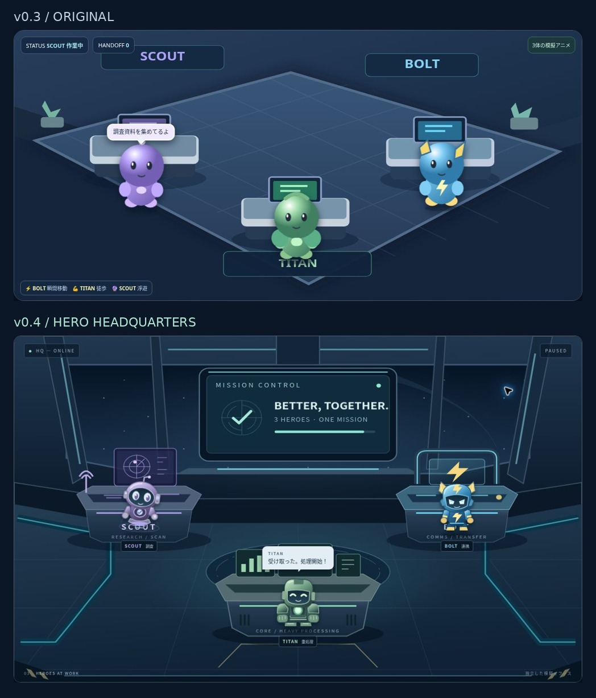

# JARVIS OFFICE v0.4 検証・レビュー記録

検証日：2026-10-21。**実装済みの確認候補です。本人の実機確認・承認前にmainへマージしません。**

## 対象と原本保全

対象は `toshinari-animego/jarvis-office-demo` のみ。作業ブランチは `feature/office-v0.4`。

取得元のmain：`92ad2b3b41e14236fe50462920d7152064dbb58d`。
元の `index.html` のGit blob：`32fb1cb8a5fd20a59e63a51b662268f4f52a741d`。
原本はGit履歴に加えて `docs/baseline-v0.3.html` として保存。
原本ファイルのSHA-256：`5065d01c02add5882dd0eeac54ecd5976fc42a3e0cf08bdbb56bc8aa92ddfb13`。

main、GitHub Pages設定、公開先は変更していません。本番JARVIS・他リポジトリ・Cloudflare・Stripeには接続していません。APIキー・Secrets・実業務データの取得はありません。有料サービス・推論API・外部ライブラリは使っていません。

## 実装した変更

| 項目 | 結果・実装箇所 |
|---|---|
| サイズ | 小画面：75→64px、約14.7%縮小。最大幅：117→100px、約14.5%縮小。`styles.css` の `.agent`。SVGの形状が異なるので、見かけの面積比とCSS幅の比率は同じではありません。 |
| BOLT | 青／黄の稲妻フィン、斜めの目、細身の装甲と発光ライン。予備動作→雷化→本体消失→相手正面へ出現→手渡し→得意げな反応→雷で帰還。`sprites.js`、`Simulation.snapshot()`、`drawHero()`。通常歩行・座標の連続スライドは使用しません。 |
| TITAN | 緑／濃灰、幅広い肩・大型アーム・胸部コア・短い脚。顔を上げ、沈み込んで立つ予備動作、歩行中の体重移動と腕・脚の振り、両腕の受領反応。 |
| SCOUT | 紫／銀、丸い頭、大きい観察眼、アンテナ・センサー・浮遊ユニット。上下浮遊、緩い傾き、視線移動、スキャンリング、発見時の表情、滑らかな移動。 |
| 基地 | パノラマ窓・金属パネル・床の光路・中央ミッションモニター。通信転送／重処理／レーダーの専用コンソールを分けたSVGの2.5D表現。外部画像なし。 |
| 手渡し | 送信者と受信者がともに反応。成果物は手元に保持し、接触地点を共有した後に受信者側へ所有権を切り替える。受信者も戻ってから次の仕事を始める。 |
| 状態管理 | `simulation.js` の純粋なタイムライン。6方向をシャッフルし、連続する6件で全方向を扱う。進行中／停止中の再要求を拒否。完了数は受領時、履歴は復帰と作業開始後に更新。履歴は最大12件。 |
| 制御 | `app.js` の単一requestAnimationFrame時計で位置・表情・浮遊・効果・成果物を一括制御。一時停止・再開・リセット、自動／手動の切替。背景タブでは進行しない。 |
| UI | 会話と業務状態を分離。44px以上の操作領域、固定のDEMO / SIMULATION表示、状態カード、引き継ぎ履歴。 |
| 動きを減らす | OS設定を読み、浮遊・揺れ・スキャン・四肢の反復を抑え、各段階を短縮。機能経路は維持。実機OS設定の確認は未実施。 |

実装途中で、フレーム経過時間を50msで切り捨てると低頻度描画環境で極端に遅くなる問題を確認。可視状態の実経過時間を使用するよう修正し、停止・再開操作とタブの可視状態変更時に時計を取り直しました。

## 検証結果

| 項目 | 判定 | 確認範囲 |
|---|---|---|
| 自動再生・3体 | 成功 | Chromeで初期自動実行と引き継ぎを観測。コアではシャッフルの6方向網羅を検証。 |
| 6方向の手動引き継ぎ | 成功 | ブラウザー上で全6組を完走。各組で受領1回、履歴1件、受信者の実行中、3体のみ表示を確認。 |
| 停止・再開 | 成功 | 各方向のUIテストで位置・表情・効果・成果物・進捗の属性が停止中に変化しないことを確認。コアでは雷化中など9段階で全スナップショット不変を確認。 |
| リセット・連打 | 成功 | ブラウザーで自動／停止／リセット30回、各引き継ぎで30回の連打。コアで進行中の1000回の再要求を拒否。消失中からのリセットも確認。 |
| BOLTの雷化・出現位置 | コア成功／映像の全フレーム未確認 | コアで本体不可視、出発点と到着点の非連続切替、相手の前への配置を確認。ブラウザーでは短い段階を観測しきれない組があり、映画的な見栄えの最終評価は本人確認へ残す。 |
| TITAN／SCOUTの移動・受領・復帰 | 成功 | 全方向で完了、受信者が自席に戻り作業開始。重量感・浮遊の好みは本人評価が必要。 |
| 長時間 | 模擬時間で成功 | 60Hzで30分相当（108,000回のtick）。所有者は最大1体、履歴上限、完了数の単調増加を確認。実時間30分のSafari負荷試験は未実施。 |
| スマートフォン／タブレット幅 | 成功 | Chrome内iframeの320／375／390／768／1024／1156 CSS px。全幅で横はみ出しなし。ボタン・選択欄は高さ44px以上。実端末のエミュレーターではなく、ブラウザーの幅変更による確認。 |
| 回転相当の幅変更 | コア成功／表示測定成功 | 進行中の目的地間隔を再計算。コアで間隔180→95への更新後も受領が完了。 |
| JavaScript | 成功（観測範囲） | 構文確認、Nodeテスト24件すべて成功、アプリURLを対象にしたブラウザーログにエラーなし。ブラウザー拡張機能由来のメタデータ送信エラーはアプリと分けて扱った。 |
| 外部通信 | 成功（観測範囲） | Resource Timingには同一オリジンのCSS／JS4件のみ、外部リソース0件。実行コードにfetch等なし。CSP `connect-src 'none'`。パケット全体のキャプチャは行っていない。 |
| 機密情報 | 成功（検査範囲） | 変更ファイルの確認・一般的なトークン形式の検査で認証情報なし。Secrets設定を読む機能は使用せず。 |
| 実機Safari／WebKitシミュレーター | 未確認 | 利用できないため未実施。iPhone／iPadでのFPS、発熱、タッチ感、OSの動き抑制設定は断定しない。 |
| main／公開ページ | 維持 | 作業ブランチのみ。公開設定・デプロイ・マージは未実施。 |

再現：`node --test tests/*.test.mjs`。ブラウザー用：`npm run dev` → `/docs/review.html`。

記録：

- [コアテスト出力](unit-test-output.txt)
- [ブラウザーの6方向UIテスト](browser-ui-test.txt)
- [6画面幅の測定値](viewport-measurements.json)
- [通信・アプリログ観測](browser-audit.json)

実行時の5テキストファイルは合計57,683バイト（圧縮前・画像や文書などのレビュー資料は除外）。外部依存なし。通信記録はプレビュー環境で取得したもので、GitHub Pagesデプロイ後の記録ではありません。

## 比較画面

すべて実際のブラウザー画面です。比較画像は基地部分を切り出して幅を揃えたものです。モバイル画像は同じ停止状態の重なり合う上下画面を座標に従って連結しています。キャプチャ出力の寸法差は共通の画面座標へ正規化。描かれていないUIを付け足してはいません。

フルページのキャプチャはツールのタイムアウトで取得できなかったため、ビューポートのキャプチャを使用しました。

[デスクトップ](previews/v0.4-desktop.jpg) ／ [375pxのモバイル画面](previews/v0.4-mobile-375.jpg) ／ [v0.3原本画面](previews/v0.3-desktop.jpg)

## 残る確認と推奨判断

**mainへの反映は現時点で保留を推奨。** 実装・自動検証・Chrome表示確認は通過しています。本人のiPhone／iPad Safariで、6方向、停止・再開、瞬間移動の見え方、TITANの重さ、SCOUTの浮遊、文字とタッチ操作、数分間の連続再生を確認し、デザインと動きが希望に合うと承認した後にマージする判断が適切です。

Safariの実機性能と本人の主観的な品質評価を確認できていないため、「全完成条件を実測で満たした」とは判定していません。現行v0.3の公開を維持したままレビューできます。
